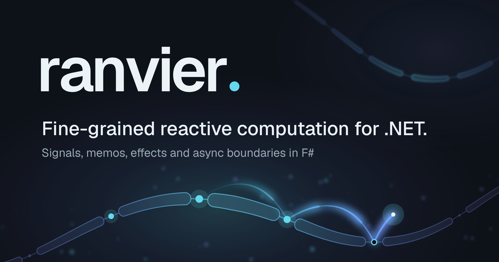

<p align="center">
  
</p>

<p align="center">
  <a href="https://ranvier-org.github.io/Ranvier/">Documentation</a>
  &middot;
  <a href="https://ranvier-org.github.io/Ranvier/benchmarks/">Benchmarks</a>
  &middot;
  <a href="LICENSE">MIT License</a>
</p>

> The nodes of Ranvier are the short gaps in the myelin sheath along a nerve fibre, named after the
> French anatomist Louis-Antoine Ranvier. A signal jumps from node to node and is regenerated at each
> one, instead of flowing along every point of the fibre.

> **Preview.** Ranvier is pre-release (`0.2.3` core packages, `0.1.1` DOM packages). Its APIs may change
> before 1.0. Install from NuGet as [`Ranvier`](https://www.nuget.org/packages/Ranvier), or
> [`Ranvier.CSharp`](https://www.nuget.org/packages/Ranvier.CSharp) from C#.
> [`Ranvier.Elmish`](https://www.nuget.org/packages/Ranvier.Elmish) adds an Elmish-style MVU bridge,
> [`Ranvier.Query`](https://www.nuget.org/packages/Ranvier.Query) adds shared remote queries and mutation reconciliation,
> [`Ranvier.Wire`](https://www.nuget.org/packages/Ranvier.Wire) provides cross-target JSON wire codecs, and
> [`Ranvier.Dom`](https://www.nuget.org/packages/Ranvier.Dom) / [`Fable.Ranvier.Dom`](https://www.nuget.org/packages/Fable.Ranvier.Dom)
> supply generated DOM contracts. Every packable library ships an untraced package and a `.Traced` variant.
> See [Installation](docs/content/guide/installation.md) for package details, target frameworks, and Fable packaging.

## Overview

Ranvier connects signals, memos and effects in a reactive graph. Signals hold writable state;
memos derive values and recompute on demand after their inputs change; effects run side effects
after changes. Async sources carry an explicit Pending state, and boundaries handle pending or failed reads.

From F#, through `Ranvier`:

```fsharp
open Ranvier

use graph = new Graph ()

graph.Run (fun () ->
    let count = createSignal 1
    let doubled = createMemo (fun _ -> count.Value * 2)
    createEffect (fun () -> printfn "doubled = %d" doubled.Value)
    count.Value <- 5)
```

From C#, through `Ranvier.CSharp`:

```csharp
using Ranvier;
using Ranvier.CSharp;
using static Ranvier.CSharp.Reactive;

using var graph = new Graph();

graph.Run(() =>
{
    var count = Signal(1);
    var doubled = Memo(() => count.Value * 2);
    Effect(() => Console.WriteLine($"doubled = {doubled.Value}"));
    count.Value = 5;
});
```

Read the [full documentation](https://ranvier-org.github.io/Ranvier/).

## Features

- [Owners and cleanup](docs/content/guide/roots.md) release child computations and cleanups together in reverse acquisition order.
- [Fixed-dependency bindings](docs/content/guide/bindings.md) copy one signal or memo into a target without dynamic dependency tracking.
- [Stream memos](docs/content/guide/streams.md) fold the items of a running stream into one node and restart the stream when its inputs change.
- [Debounce and throttle](docs/content/guide/timing.md) control when captured values reach downstream readers and async requests.
- [Collections](docs/content/guide/collections.fsx) provide editable keyed sources, per-row projections, change readers, views and aggregates.
- [Queries and mutations](docs/content/guide/queries.md) share acquired remote data, retain accepted data during refresh, and reconcile loaded queries in one batch.
- [Wire codecs](src/Ranvier.Wire/README.md) encode and decode matching JSON payloads across .NET (including NativeAOT) and Fable.
- [Shared DOM contracts](src/Ranvier.Dom/README.md) expose generated WebKit IDL interfaces across .NET and Fable.
- [Formal proofs](proofs/README.md) machine-check graph invariants, execution soundness, async flights, and collection incrementality in Rocq and Iris.
- [Views](https://ranvier-org.github.io/Ranvier.View/) use typed F# components for browser rendering, server HTML and hydration. They are built in [ranvier-org/Ranvier.View](https://github.com/ranvier-org/Ranvier.View), with [typed CSS](https://github.com/ranvier-org/Ranvier.Css) and [persistence](https://github.com/ranvier-org/Ranvier.Persistence) in their own repositories.
- [Fable](docs/content/fable/index.md) compiles the same model to JavaScript. Package builds include standalone Fable source projects, and CI checks package consumers. The guide documents target differences.

## Examples

[Ranvier.Examples](https://github.com/shayanhabibi/Ranvier.Examples) holds complete F# and C# applications
built on Ranvier, each as a console scenario and as a tab of an Avalonia desktop workbench:

- **Support workbench** (F#): a local HTTP ticket service with drafts, version conflicts, reconnection and saves that outlive the editor.
- **File processing** (C#): SHA-256 hashing of real files with bounded concurrency, keyed lists, cancellation, retry and throttled progress.
- **Data quality** (F#): CSV import, repair of malformed measurements, unit conversion, drafts across reloads and export.
- **Elmish expense review** (F#, `Ranvier.Elmish`): an immutable model with commands, selectors, validation and undo/redo.

The repository references Ranvier through a git submodule, so clone it with `git clone --recurse-submodules`.
See [Examples](docs/content/guide/examples.md) in the guide for each workflow and how to run it.

## Origin

Ranvier began as experiments in a repository called Partas.Signals.

## Contributing

Repository tasks run through `build.fsx`, a [Partas.Build](https://github.com/shayanhabibi/partas.build) script (`dotnet fsi build.fsx -- --help`).
See [CONTRIBUTING.md](CONTRIBUTING.md) for the build CLI, git hooks, commit rules, and PR checks, [AGENTS.md](AGENTS.md) for coding-agent tooling, and [Publishing packages](docs/releasing.md) for release automation.

## Layout

```
build.fsx                         the build CLI
src/Ranvier/                      the core reactive graph library
src/Ranvier.CSharp/               the C# façade
src/Ranvier.Elmish/               the MVU bridge (Mvu)
src/Ranvier.Query/                shared remote queries and mutation reconciliation
src/Ranvier.Wire/                 the JSON wire codec (vendors Thoth.Json)
src/Ranvier.Dom/                  generated WebKit DOM contracts for .NET
src/Fable.Ranvier.Dom/            generated WebKit DOM contracts for Fable
src/Ranvier.Mcp/                  local MCP graph-inspection adapter (unpacked)
proofs/                           Rocq and Iris formal verification and Navigator site
examples/                         workload benchmarks, MCP sample, and dictionary app
tests/                            Expecto, xUnit, wire, MCP, NativeAOT, and DOM mutation suites
docs/docs.fsproj                  the Nacara documentation site (net10.0)
docs/content/                     the guide, concepts, and benchmark pages
fable/                            Fable test suites and counter scenarios
bench/                            BenchmarkDotNet suites
```

## License

[MIT](LICENSE). Copyright (c) 2026 Shayan Habibi.
